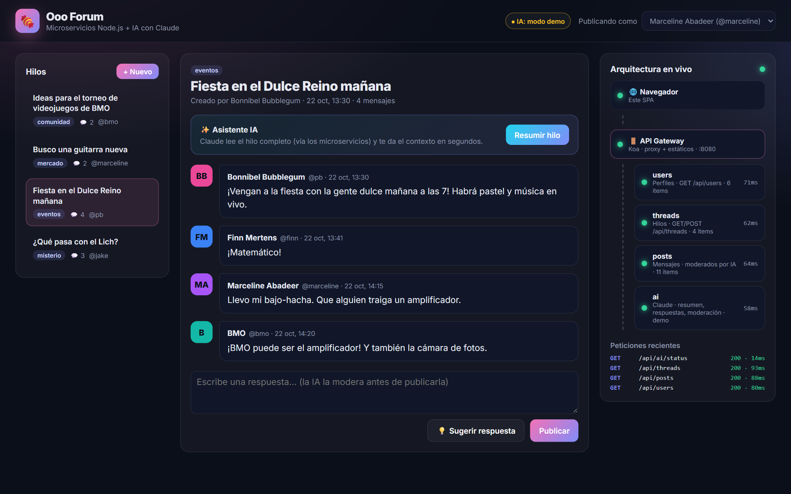
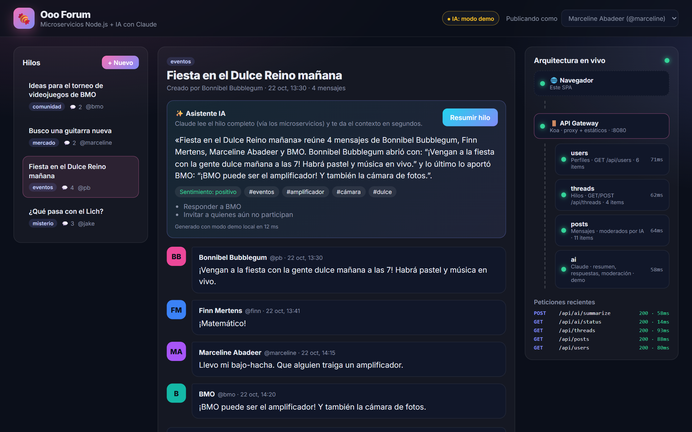
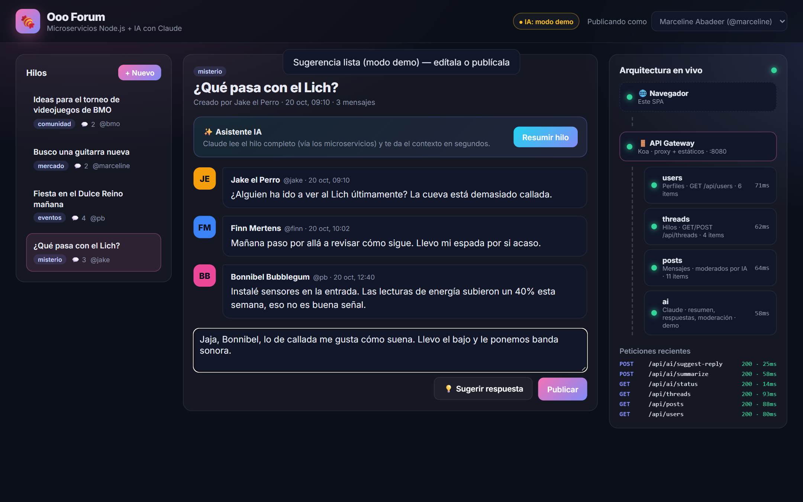
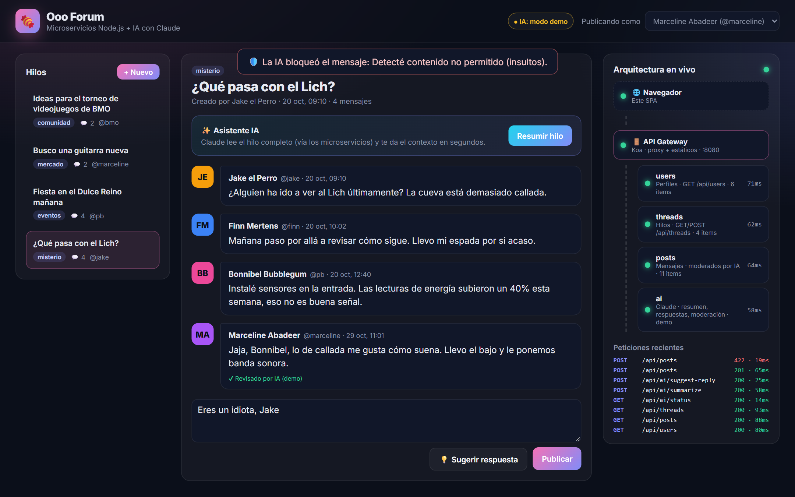
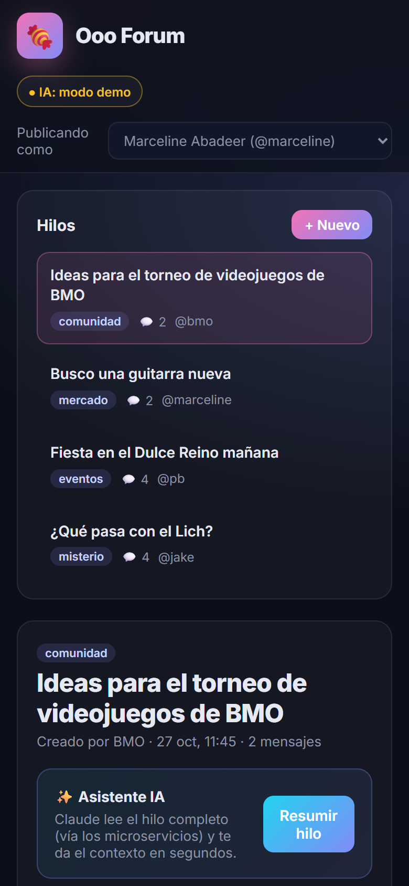
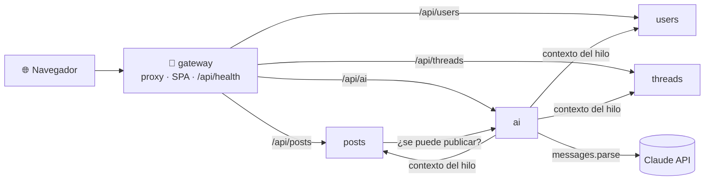
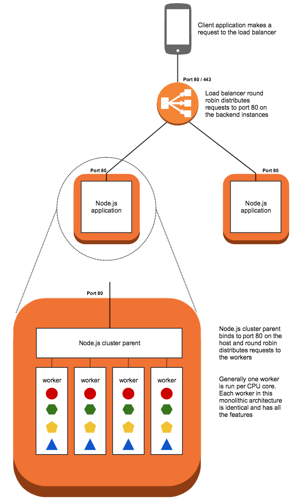
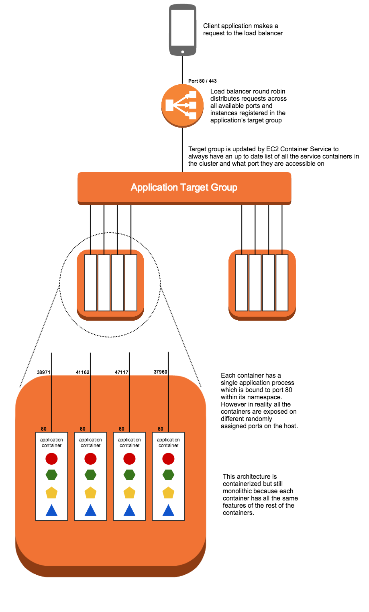
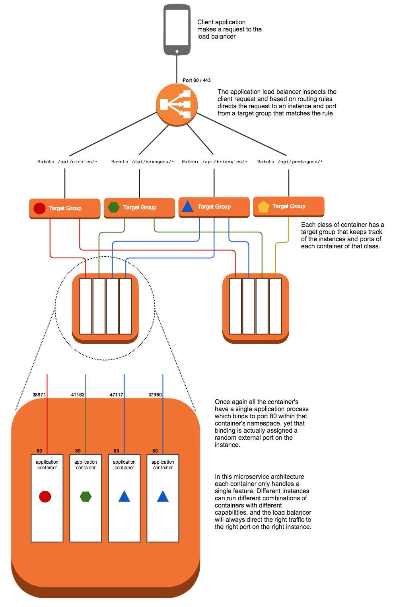

<div align="center">

# 🍬 Ooo Forum: del monolito a microservicios con IA

**Cómo evoluciona una aplicación Node.js desde un servidor monolítico hasta una plataforma de
microservicios en contenedores, desplegable en AWS ECS y con un servicio de IA basado en Claude.**




</div>

## ✨ Qué es

Un recorrido práctico en cuatro etapas. Cada carpeta es una versión funcional del mismo producto
(un foro), y cada una resuelve un problema que la anterior no podía:

| Etapa | Carpeta | Arquitectura | Qué aprendes |
|:-----:|---------|--------------|--------------|
| 1 | [`1-no-container`](1-no-container/) | Monolito con `cluster` de Node | Usar todos los núcleos de un servidor |
| 2 | [`2-containerized`](2-containerized/) | Monolito en un contenedor en ECS | Empaquetar y desplegar con Docker + ECR |
| 3 | [`3-microservices`](3-microservices/) | 3 servicios detrás de un ALB | Separar por dominio y rutear por prefijo |
| 4 | [`4-ai-microservices`](4-ai-microservices/) | 5 servicios + gateway + **IA** + web | Comunicación entre servicios, resiliencia y LLMs en producción |

## 📸 Capturas

<table>
  <tr>
    <td width="50%">
      <b>Resumen del hilo con IA</b><br>
      Sentimiento, temas y próximos pasos, generados a partir de los datos de tres microservicios.
      
    </td>
    <td width="50%">
      <b>Respuesta sugerida</b><br>
      La IA escribe la siguiente respuesta con la personalidad del usuario elegido.
      
    </td>
  </tr>
  <tr>
    <td width="50%">
      <b>Moderación automática</b><br>
      <code>posts</code> consulta a <code>ai</code> antes de guardar; un insulto devuelve <code>422</code>.
      
    </td>
    <td width="50%" align="center">
      <b>Diseño responsive</b><br>
      
    </td>
  </tr>
</table>

> Las capturas se tomaron en **modo demo** (sin `ANTHROPIC_API_KEY`), donde un motor local
> determinista sustituye a Claude. Con una API key, las mismas pantallas muestran respuestas
> generadas por Claude y la insignia cambia a `IA: Claude`.

## 🏗️ Arquitectura de la etapa 4



- **API Gateway**: rutea por prefijo, igual que las reglas del ALB de la etapa 3, y agrega la salud
  de todos los servicios. El panel *Arquitectura en vivo* de la web la muestra cada 5 segundos.
- **Servicio de IA**: usa el SDK oficial `@anthropic-ai/sdk` con salidas estructuradas validadas con
  Zod. Si no hay API key o la API falla, responde con un motor demo y lo indica.
- **Resiliencia**: si `ai` no responde, `posts` publica igual. La IA suma funciones, pero si falla
  no se cae el foro.

Las etapas 1 a 3 conservan sus diagramas originales de AWS:

| Monolito sin contenedor | Monolito en contenedor | Microservicios |
|:---:|:---:|:---:|
|  |  |  |

## 🚀 Inicio rápido

**Requisitos:** Node.js 22+ y, opcionalmente, Docker.

```bash
git clone https://github.com/zemogc/Microservices_nodejs.git
cd Microservices_nodejs

# Opción A: Docker (todo aislado)
cd 4-ai-microservices
docker compose up --build

# Opción B: Node directo
npm install
npm run dev
```

Abre **http://localhost:8080**.

Para activar Claude, define la variable antes de arrancar:

```bash
export ANTHROPIC_API_KEY=sk-ant-...      # PowerShell: $env:ANTHROPIC_API_KEY="sk-ant-..."
export CLAUDE_MODEL=claude-opus-5-5      # opcional
```

### Probar la API

```bash
curl localhost:8080/api/health
curl -X POST localhost:8080/api/ai/summarize -H 'content-type: application/json' -d '{"threadId":2}'
curl -X POST localhost:8080/api/posts -H 'content-type: application/json' \
     -d '{"thread":1,"user":2,"text":"¡Voy con ustedes!"}'
```

### Tests

```bash
npm test
```

Son 21 pruebas con `node:test`, sin dependencias extra. Cubren cada servicio, el gateway y el
servicio de IA en ambos modos. El modo Claude se prueba contra un servidor falso de la Messages API
que valida el modelo, el `effort` y el esquema JSON que se envían.

## ☁️ Despliegue en AWS

Las etapas 2 y 3 incluyen la plantilla de CloudFormation (`infrastructure/ecs.yml`) y un
`deploy.sh` que construye las imágenes, las sube a ECR, registra las task definitions y crea las
reglas del ALB:

```bash
cd 3-microservices
aws cloudformation deploy --template-file infrastructure/ecs.yml --region us-east-1 \
    --stack-name ooo --capabilities CAPABILITY_NAMED_IAM
./deploy.sh us-east-1 ooo     # requiere docker, aws cli v2 y jq
```

Para correr la etapa 3 en local sin AWS, `docker compose up` levanta los servicios con un nginx que
replica las reglas del ALB en `http://localhost:8080`.

## 🧱 Stack

| Capa | Tecnología |
|------|------------|
| Runtime | Node.js 22, Koa 3, `@koa/router` |
| IA | Claude (`@anthropic-ai/sdk`), salidas estructuradas con Zod |
| Frontend | HTML, CSS y JavaScript sin frameworks ni build |
| Contenedores | Docker (`node:22-alpine`, usuario sin privilegios, `HEALTHCHECK`), Docker Compose |
| Nube | AWS ECS, ECR, Application Load Balancer, CloudFormation |
| Pruebas | `node:test` |

## 📁 Estructura

```
.
├── 1-no-container/        # Monolito + cluster
├── 2-containerized/       # Monolito en Docker/ECS
├── 3-microservices/       # users · threads · posts + ALB (o nginx en local)
├── 4-ai-microservices/    # Ooo Forum: 5 servicios, IA, web, tests
│   ├── services/
│   │   ├── users/ threads/ posts/
│   │   ├── ai/            # claude.js (SDK) · demo.js (motor local)
│   │   └── gateway/       # proxy + public/ (SPA)
│   ├── docker-compose.yml
│   └── dev.js
├── docs/screenshots/
└── images/                # Diagramas de arquitectura AWS
```

## 🙌 Créditos

Basado en la arquitectura de referencia
[awslabs/amazon-ecs-nodejs-microservices](https://github.com/awslabs/amazon-ecs-nodejs-microservices)
(Apache 2.0). Este fork moderniza el código a Node 22 / Koa 3, corrige el despliegue para AWS CLI v2
y agrega la etapa 4 con IA, gateway, interfaz web y pruebas.

Licencia [Apache 2.0](LICENSE).
